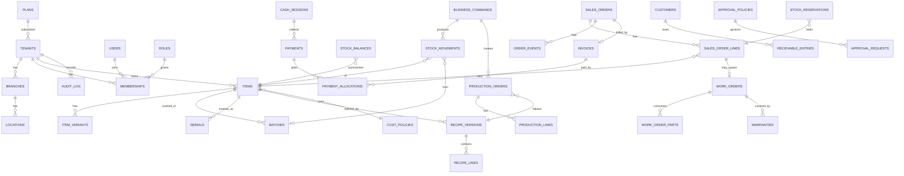

# وثيقة المنتج والمعمارية — Tijara OS

> الإصدار: **0.2 (مسودة للمراجعة)** — يحلّ محل 0.1
> الاسم «Tijara OS» **اسم عملي مؤقت** لا يُثبَّت تجارياً قبل فحص العلامة والدومين.
> **تنبيه تسمية:** اختبارات T1–T25 في هذه الوثيقة هي **خطة اختبارات قبول**، وليست اختبارات نجحت. حالة كل اختبار تُوثَّق في `docs/TEST_STATUS.md` بعد تشغيله فعلياً.

---

## سجل التغييرات (0.1 → 0.2)

| # | التغيير | السبب |
|---|---|---|
| C1 | تعريف ثلاث حالات تنفيذ للبنود: `stock` / `backflush` / `none` (القسم 5.2) | منع خصم المواد الخام مرتين بين بيع اللحم، وبيع اللحم مع الشواء، وإعداد وجبة |
| C2 | الفاقد جزء من **نتيجة أمر الإنتاج** وليس حركة خصم ثانية من المادة الخام (5.3) | 5 كلغ مدخلات = 4.6 ناتج + 0.4 فاقد؛ لا تُخصم 5.4 كلغ |
| C3 | الكمية: `on_hand` / `reserved` / `available` / حالات `damaged` و`quarantine` (5.4) | بيع من صندوق آخر لكمية محجوزة |
| C4 | الحجز والبيع محميان معاً بتحديث ذرّي، واختبار تزامن (5.5) | سباق الحجز |
| C5 | عزل: جداول عالمية ≠ جداول المؤسسة، مستخدم متعدد المؤسسات، ملفات، مهام، تدقيق (2.3) | اكتمال العزل |
| C6 | **`business_commands`**: مفتاح منع التكرار على مستوى الأمر التجاري، وعدة حركات مخزون لنفس الأمر (5.6) | القيد `(tenant_id, idempotency_key)` على `stock_movements` كان يمنع تعدد الحركات |
| C7 | فصل **اختيار المخزون المستهلك** (FEFO/FIFO) عن **تقييم التكلفة**، مع حفظ نسخة السياسة والوصفة وقت التنفيذ ومنع الأثر الرجعي (6) | قراران مختلفان |
| C8 | مخطط `work_orders` وقطع الغيار والضمان والدفعات مثبّت من الآن؛ الواجهات مؤجلة (4.4) | الخدمات المركّبة |
| C9 | فصل `track_quantity` عن تتبع الدفعات/التسلسلي (4.1) | `tracking=none` لا يعني «غير مخزني» |
| C10 | سياسة المالك الوحيد: موافقة ذاتية مشروطة (8.3) | مؤسسة صغيرة بشخص واحد |
| C11 | لحظة **الوزن ≠ البيع النهائي**: حالات سطر الطلب `reserved → weighed → committed` (7.1) | الوزن لا يعني اكتمال البيع |
| C12 | آجل بسيط اختياري ودفعات جزئية في MVP (9) | قرار المالك |
| C13 | اختبارات جديدة: فشل المعاملة في المنتصف، أنشطة مختلطة، حجز من صندوقين، إعادة إرسال متعدد الحركات، دفع جزئي (14) | |
| C14 | مصفوفة العمليات، مخطط العلاقات، حدود الوحدات، خطة تنفيذ بمعايير قبول (11–13) | |

---

## 0. القرارات المعتمدة

| # | القرار |
|---|---|
| D1 | منصة SaaS عامة متعددة المؤسسات والفروع والأنشطة؛ غير مخصصة لمهنة واحدة. |
| D2 | المؤسسة تبيع **منتجات وخدمات** معاً. |
| D3 | وحدات تُفعَّل حسب الأنشطة؛ نوع المحل يعطي قالباً أولياً فقط. |
| D4 | Modular Monolith: **TypeScript + Node.js + PostgreSQL 16 + React PWA**. لا Microservices. |
| D5 | **Stock Ledger** غير قابل للتعديل هو مرجع الكميات. |
| D6 | الفصل بين البيع والتحويل والتحضير (5.2). |
| D7 | RLS من اليوم الأول + اختبارات عزل إلزامية على قاعدة البيانات نفسها. |
| D8 | صلاحيات على مستوى العملية والفرع والموظف + موافقات. |
| D9 | لا «صافي الربح الحقيقي» بدون مؤشر اكتمال بيانات. |
| D10 | عمليات عكسية موثقة بدل التعديل/الحذف. |
| D11 | PWA أولاً. لا Marketplace ولا تطبيقات أصلية في البداية. |
| D12 | الذكاء الاصطناعي مساعد فقط ولا يعدّل المال أو المخزون تلقائياً. |
| D13 | آجل بسيط اختياري ودفعات جزئية في MVP. |
| D14 | الوزن يدوي في MVP؛ ربط الميزان مؤجل (دون تحديد ماركة). |
| D15 | بيئة اختبار منفصلة (Railway أو ما يماثله مبدئياً). **استضافة الإنتاج وموقع البيانات يُحسمان بعد مراجعة الأمان والامتثال.** لا نشر على الإنتاج. |

افتراضات لم يُتحقق منها: الضريبة (TVA) قابلة للضبط وتُراجع مع محاسب؛ أحكام CNDP/09-08 ونقل البيانات؛ دعم تعديل حجز البطاقة غير مفترض.

---

## 1. الرؤية

منصة موحدة لإدارة المؤسسات التجارية والخدمية. الوعد: صاحب المحل يعرف في أي لحظة ماذا اشترى وباع واستهلك وخسر وكم ربح، **بأرقام يثق بها**. التمايز: دقة العمليات، تعدد الأنشطة بمخزون واحد، وضع مبسط للموظفين، وعزل صارم.

---

## 2. المعمارية

### 2.1 الطبقات
```
1) النواة: tenancy، identity/access، catalog، inventory، sales، payments/cash، purchasing، audit، reporting
2) وحدات متخصصة: production (تحويل/تحضير)، weighed sales، batches، serial/warranty،
   restaurant (طاولات/مطبخ)، delivery، services (work orders)، B2B، online ordering
3) مساعد وأتمتة (مؤجل)
```

### 2.2 التقنية
Node.js 22 + TypeScript، PostgreSQL 16، Redis + عامل مهام (مرحلة لاحقة)، React PWA، Object storage بمسار يبدأ بـ `tenant_id`.

### 2.3 العزل (محدّث)
1. **جداول عالمية (بدون `tenant_id`)**: `plans`, `business_templates`, `permissions_catalog`, `users` (هوية)، `platform_admins`. محمية بدور مختلف وصلاحيات قراءة فقط للتطبيق.
2. **جداول المؤسسة**: كل جدول يحتوي `tenant_id`، **RLS مفعلة + FORCE**، ومفاتيحها الأجنبية مركّبة `(tenant_id, id)` فلا يمكن الإشارة إلى سجل مؤسسة أخرى.
3. **أدوار قاعدة البيانات**: `app_owner` (مالك الجداول والترحيلات، لا يُستخدم وقت التشغيل)، `app_runtime` (`NOSUPERUSER NOBYPASSRLS`، وبدون ملكية الجداول)، `app_platform` (للوحة المنصة، مسار منفصل ومُدقَّق). أدوار `superuser`/`BYPASSRLS` تتجاوز RLS فلا تُستخدم وقت التشغيل.
4. **المستخدم متعدد المؤسسات**: `users` عالمي، و`memberships` تربطه بمؤسسات. المؤسسة النشطة تُختار في الجلسة وتُتحقق من العضوية ثم `SET LOCAL app.tenant_id`.
5. **سياق المؤسسة** يُضبط داخل كل معاملة؛ غيابه = لا صفوف (السياسة تعتمد `current_setting('app.tenant_id', true)`).
6. **الملفات**: المسار `tenants/{tenant_id}/...` وروابط موقّعة قصيرة الأجل مع تحقق عضوية.
7. **سجل التدقيق والمهام والتقارير**: `audit_log` عليه RLS؛ كل مهمة خلفية تحمل `tenant_id` وتضبط السياق؛ التقارير تعمل بدور `app_runtime` وتحترم RLS (لا مشاهد `SECURITY DEFINER` تتجاوزها دون مراجعة).
8. **الدعم الفني**: تفويض مؤقت من المالك + سجل تدقيق + شارة ظاهرة.

---

## 3. المؤسسة والتهيئة

القوالب (`business_templates`) تقترح الوحدات والوحدات القياسية والأدوار والتقارير؛ `tenant_modules` و`tenant_settings` (JSONB بمخطط تحقق)؛ `plans`/`subscriptions`/`quotas` تُفرض في الخدمة وفي القاعدة حيث أمكن. التخصيص بالإعدادات للاختلافات المعروفة فقط؛ أي منطق مهني جديد = وحدة جديدة مختبرة.

---

## 4. المنتجات والخدمات

### 4.1 العنصر (`items`) — الخصائص المنفصلة
| الحقل | القيم | الملاحظة |
|---|---|---|
| `kind` | `goods` / `service` / `composite` | السلعة، الخدمة، المركّب (وجبة/حزمة) |
| `track_quantity` | bool | **هل يُدار في المخزون** (مستقل عن التتبع) |
| `batch_tracking` | `none` / `optional` / `required` | الدفعات والصلاحية |
| `serial_tracking` | bool | IMEI/رقم تسلسلي وضمان |
| `fulfillment` | `stock` / `backflush` / `none` | كيف يؤثر بيعه على المخزون (5.2) |
| `base_uom` | قطعة / غ / مل … | تُخزَّن الكميات بوحدة الأساس |
| `attributes` | JSONB بمخطط القالب | |
| `cost_policy_id` | | سياسة التكلفة والاختيار (6) |

قاعدة تحقق: `kind=service` ⇒ `track_quantity=false` و`fulfillment='none'`؛ `serial_tracking` ⇒ `track_quantity=true`.

### 4.2 جداول
`items`, `item_variants`, `uom`, `uom_conversions`, `categories`, `price_lists`, `price_list_items`, `barcodes`, `recipes` (**بنسخ**: `recipe_versions`, `recipe_lines`)، `batches`, `serials`.

### 4.3 الخدمات في MVP
سطر فاتورة بسعر. الخدمة **الصرفة** `kind=service` لا تمس المخزون أبداً (`fulfillment=none`، يفرضه قيد في القاعدة). أما الخدمة التي **تستهلك مواد** (شواء بالفحم، تركيب بقطع صغيرة) فتُمثَّل `kind=composite` + `fulfillment=backflush` بوصفة (مثبَّت بالتنفيذ والاختبار T21). بلا أوامر عمل في MVP.

### 4.4 أوامر العمل (مثبّتة علاقاتها الآن، واجهاتها مؤجلة)
السيناريو: مضخة مياه + تركيب + فني + قطع إضافية + دفعتان + ضمان.
- `work_orders(tenant_id, id, order_line_id, status, scheduled_at, ...)`
- `work_order_assignments` (فنيون)، `work_order_parts` (تستهلك مخزوناً عبر الـ Ledger ضمن أمر تجاري)
- `warranties(item_id | serial_id | service_line_id, starts_at, ends_at, terms)`
- الدفعات عبر `payments` + `payment_allocations` على الفاتورة (9)

---

## 5. المخزون والإنتاج

### 5.1 Stock Ledger
`stock_movements` للإضافة فقط (منع UPDATE/DELETE بصلاحيات وtrigger):

`id, tenant_id, branch_id, location_id, item_id, variant_id, batch_id, serial_id, stock_status (sellable|damaged|quarantine), qty_delta NUMERIC(14,4), unit_cost NUMERIC(14,4), movement_type, command_id, command_seq, source_doc_type, source_doc_id, reverses_movement_id, reason_code, cost_policy_version_id, created_by, created_at`

القيد الفريد: `(tenant_id, command_id, command_seq)` — **لا** على مفتاح منع التكرار.

أنواع الحركات: `receipt`, `sale`, `production_consume`, `production_output`, `backflush_consume`, `transfer_out/in`, `adjustment`, `waste`, `return_in`, `return_out`, `reversal`, `status_change`.

### 5.2 حالات التنفيذ (C1) — قاعدة الخصم الوحيدة
أثر بيع سطر الطلب على المخزون يُحدَّد بـ `items.fulfillment`:

| `fulfillment` | معنى | عند الإنجاز (commit) |
|---|---|---|
| `stock` | العنصر نفسه في المخزون (لحم نيئ، جهاز، طبق جاهز من إنتاج مسبق) | حركة `sale` بالكمية الفعلية |
| `backflush` | العنصر لا مخزون له، ويُستهلك **مكوّنات وصفته** عند الإنجاز (وجبة تُحضَّر عند الطلب، خدمة بمواد) | حركات `backflush_consume` للمكوّنات حسب نسخة الوصفة؛ **لا** حركة على العنصر نفسه |
| `none` | خدمة صرفة | لا حركة |

الحالات الثلاث المطلوبة:

| الحالة | مثال | المعالجة |
|---|---|---|
| بيع لحم نيئ | 2 كلغ لحم | سطر `stock` ⇒ `sale` للحم |
| لحم + شواء | 1.47 كلغ لحم + خدمة شواء | سطر لحم `stock` ⇒ `sale` **مرة واحدة**؛ سطر «شواء» `none` أو `backflush` (فحم/توابل فقط) ⇒ لا يمس اللحم |
| وجبة مطعم | طبق مشوي مكوّن من لحم وخبز | سطر الوجبة `backflush` ⇒ استهلاك اللحم والخبز **مرة واحدة** عبر الوصفة؛ ولا يوجد سطر بيع للحم الخام |
| وجبة من إنتاج مسبق | كفتة مصنّعة للمخزون | أمر إنتاج ينشئ مخزون «كفتة»؛ ثم سطر `stock` ⇒ `sale` للكفتة (لا استهلاك للخام ثانية) |

### 5.3 الفاقد (C2)
أمر الإنتاج (`production_orders`) يسجّل:
- **المدخلات**: حركة `production_consume` واحدة لكل مدخل (5 كلغ لحم).
- **المخرجات المفيدة**: `production_output` (+4.6 كفتة).
- **الفاقد**: سطر `production_lines(kind='waste', qty=0.4, cost, reason)` **بلا حركة خصم إضافية** من الخام، لأنه مشمول في الـ 5 كلغ المستهلكة.
- **منتج ثانوي له مخزون** (عظام للمرق): يُسجَّل كمخرج `production_output` لعنصر آخر وليس كفاقد.
- **الثابت**: `Σ المدخلات = Σ المخرجات المفيدة + Σ الثانوية + Σ الفاقد` (±سماحية مضبوطة)، ويُرفض الأمر إن اختل.

### 5.4 الكميات (C3)
`stock_balances(tenant_id, branch_id, location_id, item_id, variant_id, batch_id, stock_status, on_hand, reserved)`:
- `on_hand`: الموجود فعلياً لهذه الحالة.
- `reserved`: محجوز لطلبات مؤكدة (حجز ناعم، بلا حركة Ledger).
- `available = on_hand(sellable) − reserved`.
- `damaged`/`quarantine`: صفوف بحالة مختلفة؛ لا تدخل في المتاح للبيع. نقل بينها بحركتي `status_change`.

### 5.5 الحجز والبيع المتزامنان (C4)
- الحجز: `UPDATE stock_balances SET reserved = reserved + :q WHERE ... AND on_hand - reserved >= :q` (ذرّي، ويفشل بصفر صف).
- الإنجاز: يحوّل الحجز إلى استهلاك في **نفس المعاملة**: `on_hand -= q, reserved -= reserved_q`.
- الحجز المنتهي (`expires_at`) يُحرَّر بمهمة؛ والإنجاز يتحقق من بقاء الحجز.
- اختيار الصفوف المتعددة (دفعات): ترتيب ثابت للأقفال `ORDER BY` لتفادي deadlock، مع إعادة محاولة على `40001/40P01`.
- سياسة الرصيد السالب: إعداد صريح للمؤسسة (افتراضياً ممنوع).
- **فحص مطابقة** دوري: `stock_balances.on_hand == Σ stock_movements` (يعمل كاختبار وكمهمة مراقبة).

### 5.6 الأوامر التجارية ومنع التكرار (C6)
`business_commands(tenant_id, id, idempotency_key, command_type, request_hash, status [started|succeeded|failed], result jsonb, created_by, created_at)` مع فريد `(tenant_id, idempotency_key)`.
- كل عملية تجارية تبدأ بإدراج الأمر؛ التكرار بنفس المفتاح والـ hash ⇒ يرجع **النتيجة المحفوظة**؛ بنفس المفتاح وhash مختلف ⇒ خطأ `409`.
- حركات المخزون والفواتير والمدفوعات تحمل `command_id`، وتتعدد داخل الأمر الواحد (`command_seq`).
- **ذرّية**: الفاتورة وكل الحركات والقيود المرتبطة تُحفظ في معاملة واحدة أو لا شيء؛ ويُختبر فشل حقن في المنتصف.

---

## 6. التكلفة (C7)

قراران منفصلان في `cost_policies` (بنسخ `cost_policy_versions`):

| القرار | الخيارات |
|---|---|
| **اختيار المخزون المستهلك** | `fefo` (الأقرب انتهاءً، مع احترام السلامة ومنع المنتهي) / `fifo` / `manual` |
| **تقييم التكلفة** | `weighted_average` / `batch_actual` |
| **توزيع تكلفة الإنتاج** | `by_weight` للمخرجات المتجانسة / `by_relative_value` للمشتركة المختلفة القيمة |

قواعد:
- تُحفظ على كل حركة `cost_policy_version_id`، وعلى كل أمر إنتاج `recipe_version_id` + نسخة السياسة.
- تغيير سياسة عنصر ينشئ **نسخة جديدة** تسري على المستقبل فقط، ولا تعاد تقييم فواتير صادرة.
- تكلفة الفاقد تظهر منفصلة، وتُقارن بالفاقد المتوقع في الوصفة (انحراف).

### الربح (D9)
`هامش المواد` ثم `الربح الإجمالي` ثم `صافي تشغيلي`، مع **مؤشر اكتمال**: نسبة العناصر ذات التكلفة المعروفة + هل سُجلت الأجور والمصاريف. الناقص ⇒ يُسمى «ربح إجمالي تقديري» مع قائمة النقص.

---

## 7. الطلبات

### 7.1 حالات الطلب وسطر الطلب (C11)
الطلب: `draft → confirmed → in_preparation? → ready → delivered → closed` و`cancelled`.
سطر الطلب (للسلع/الوصفات): `draft → reserved → weighed → committed → (returned|void)`.

- `confirmed`: يُحجز المقدَّر (`reserved`).
- `weighed`: يُسجَّل الوزن الفعلي ويُعدَّل الحجز إلى الفعلي وتُحسب القيمة. **لا حركة Ledger بعد.**
- `committed` (لحظة الاستهلاك): تُحدَّد بـ `commit_point`:
  - سطر له تحضير/شواء: عند **بدء التحضير**.
  - سطر بلا تحضير: عند **الدفع أو التسليم** (أيهما أولاً حسب إعداد الفرع، الافتراضي: الدفع).
- بيع الكاونتر الفوري يجمع المراحل في أمر واحد.

### 7.2 الإلغاء والتصحيح
| الحالة | الأثر |
|---|---|
| قبل `committed` (بما فيها بعد الوزن) | تحرير الحجز فقط؛ لا حركة Ledger |
| بعد `committed` وقبل التسليم، المنتج سليم وغير مُحضَّر | `return_in` عكسي بموافقة، وبحالة `sellable` |
| بعد `committed` وأثناء الشواء/التحضير | `waste` (أو بيع بخسارة) بسبب موثق |
| خطأ وزن بعد الالتزام | حركة تصحيح (عكس + جديدة) بصلاحية وسبب وموافقة فوق حد |
| مرتجع بعد التسليم | `return_in` (sellable أو damaged حسب فحص مسؤول) + سجل `refunds` |
| إعادة إرسال نفس الأمر | يرجع النتيجة المحفوظة (5.6) |

---

## 8. الصلاحيات والموافقات

### 8.1 النموذج
`permissions_catalog` (عالمي) · `roles` · `role_permissions` · `memberships(user, tenant, role, branch_scope[])` · `approval_policies(action, threshold, approver_role)` · `approval_requests` · `audit_log` للإضافة فقط.

### 8.2 الأدوار الافتراضية
مالك، مدير فرع، كاشير، جزار، شواء/طباخ، نادل، مسؤول مخزون، سائق، محاسب، فني (لاحقاً).

### 8.3 المالك الوحيد (C10)
- الأصل: لا يوافق أحد على طلب أنشأه هو.
- **استثناء**: في مؤسسة فيها **مستخدم نشط واحد** (أو `owner_self_approval=true`)، يسمح بـ **موافقة ذاتية** بشرط: تحقق إضافي (إعادة إدخال كلمة المرور/OTP)، وسبب مكتوب، ووسم `self_approved=true` في الموافقة والتدقيق، وسقف قيم يُعلن بسياسة، وظهورها في تقرير «الموافقات الذاتية».

---

## 9. المدفوعات والآجل والصندوق (C12)

- `payments(tenant_id, id, method [cash|card|transfer|credit], amount, customer_id?, cash_session_id?)`
- `payment_allocations(payment_id, invoice_id, amount)`: دفعة واحدة توزَّع على فواتير، وفاتورة تتلقى عدة دفعات (دفعات جزئية).
- **آجل بسيط**: `customer_accounts` و`receivable_entries` (charge عند إصدار فاتورة آجلة، payment عند التحصيل). رصيد العميل = مجموع القيود. حد ائتمان اختياري بسيط. الإدارة المتقدمة (تقادم، فوائد) مؤجلة.
- **جلسة الصندوق**: افتتاحي ← حركات ← إغلاق (المتوقع من المقبوضات النقدية − المرتجعات − المصروفات + الافتتاحي) مقابل المعدود، والفرق يسجَّل بسبب وبموافقة فوق عتبة.
- الفواتير: ترقيم متسلسل لكل مؤسسة (جدول عدادات بقفل)، `void` بإشعار دائن لا حذف. المبالغ `NUMERIC(14,2)` مع قاعدة تقريب موحدة موثقة.

---

## 10. الواجهات
POS الكاشير، شاشة التحضير/المطبخ، واجهة الجزار، لوحة المالك، PWA الزبون (طلب بلا حساب إلزامي)، لوحة المنصة. عربي/فرنسي RTL، وضع مبسط. Offline مرحلة 2 (لا يشمل البطاقة).

---

## 11. مخطط العلاقات النهائي للمكونات الأساسية



**الجداول**: عالمية = `plans, business_templates, permissions_catalog, users, platform_admins`؛ باقي الجداول للمؤسسة (RLS).

---

## 12. مصفوفة العمليات

الرموز: **OH** = on_hand، **RS** = reserved، **L** = حركة Ledger، — = لا أثر.

| # | العملية | المخزون | الطلب/السطر | المدفوعات | ملاحظات |
|---|---|---|---|---|---|
| O1 | استلام مشتريات | L:`receipt` (+OH) وإنشاء دفعة وتكلفة | — | دين مورد (اختياري) | أمر تجاري واحد |
| O2 | إنشاء طلب | — | draft | — | |
| O3 | تأكيد طلب | RS+ (تقدير) | confirmed / reserved | — | يفشل ذرّياً إن لم يتوفر متاح |
| O4 | وزن فعلي | RS تُعدَّل للفعلي | weighed | — | لا L |
| O5 | بدء تحضير | L حسب `fulfillment` (commit) | committed، in_preparation | — | RS− و OH− معاً |
| O6 | بيع كاونتر نيئ | O3+O4+O5 مجمعة | closed | دفع | معاملة واحدة |
| O7 | بيع لحم + خدمة شواء | L `sale` للحم فقط؛ مواد الخدمة `backflush` | سطران | — | لا خصم مزدوج |
| O8 | وجبة backflush | L `backflush_consume` للمكوّنات | سطر وجبة | — | لا سطر للخام |
| O9 | أمر تحويل | L: consume مدخلات + output مخرجات؛ الفاقد سطر وثيقة | — | — | ثابت الكتلة |
| O10 | إنتاج للمخزون (تحضير) | consume + output لعنصر مُجهَّز | — | — | ثم `sale` للمجهّز |
| O11 | إلغاء قبل commit | RS− فقط | cancelled | رد إن دُفع | |
| O12 | إلغاء بعد commit (سليم) | L `return_in` (بموافقة) | cancelled | رد | |
| O13 | إلغاء أثناء التحضير | L `waste` | cancelled | رد حسب السياسة | |
| O14 | تصحيح وزن | L عكس + جديد | line corrected | فرق سعر | موافقة |
| O15 | مرتجع بعد التسليم | L `return_in` (sellable/damaged) | returned | refund | |
| O16 | دفع نقدي كامل | — | — | payment + allocation | |
| O17 | دفع جزئي / آجل | — | — | payment جزئي + receivable | |
| O18 | تحصيل لاحق | — | — | payment + allocation + receivable− | |
| O19 | جرد/تلف | L `adjustment`/`waste`/`status_change` | — | — | موافقة فوق عتبة |
| O20 | تحويل بين فروع | L `transfer_out` ثم `transfer_in` | — | — | |
| O21 | إغلاق صندوق | — | — | cash_session + فرق | موافقة فوق عتبة |
| O22 | أمر عمل + قطع | L استهلاك قطع (`sale`/`backflush_consume`) | work_order | دفعات | مثبّت مخططياً فقط |

---

## 13. وحدات النواة وحدود الاعتماد

| الوحدة | المسؤولية | تعتمد على |
|---|---|---|
| `platform` | الباقات، القوالب، إدارة المؤسسات (عالمي) | — |
| `identity` | المستخدمون، العضويات، الجلسات | platform |
| `access` | الأدوار، الصلاحيات، الموافقات، التدقيق | identity |
| `catalog` | العناصر، الوصفات، سياسات التكلفة | access |
| `inventory` | Ledger، الأرصدة، الحجوزات، الدفعات | catalog |
| `production` | أوامر التحويل والتحضير | inventory, catalog |
| `sales` | الطلبات، الفواتير، الإلغاء | inventory (عبر واجهة)، catalog |
| `payments` | المدفوعات، الآجل، الصندوق | sales (قراءة)، access |
| `purchasing` | الموردون، الاستلام | inventory |
| `services` | أوامر العمل، الضمان | sales, inventory (لاحقاً) |
| `reporting` | تقارير القراءة فقط | الكل (قراءة) |
| `commands` | الأوامر التجارية وIdempotency | — (مستخدمة من الجميع) |

قواعد: لا دورات اعتماد؛ `inventory` لا يعرف `sales`؛ الوحدات تتخاطب عبر واجهات (functions) لا بالوصول لجداول بعضها؛ يُفرض بفحص آلي للاستيراد (dependency-cruiser أو ما يماثله) في CI.

---

## 14. خطة الاختبارات (قبول — لم تُنفَّذ بعد)

| # | السيناريو | المعيار |
|---|---|---|
| T1 | بيع 1.47 كلغ كفتة مشوية (130 + شواء 20) | الإجمالي 220.50، حركة `sale` واحدة للكفتة، سطر الشواء بلا حركة على الخام |
| T2 | تحويل 5 كلغ لحم ← 4.6 كفتة + 0.4 فاقد | consume −5 واحدة، output +4.6، فاقد سطر وثيقة، **لا خصم 5.4**، الثابت محقق |
| T3 | إلغاء قبل الوزن | تحرير الحجز، لا L |
| T4 | إلغاء بعد الوزن قبل commit | تحرير الحجز، لا L |
| T5 | إلغاء بعد commit قبل التحضير | `return_in` بموافقة، وإلا waste |
| T6 | إلغاء أثناء الشواء | waste بسبب |
| T7 | حجز من صندوقين لـ 10 كلغ (7 محجوزة ثم طلب 5) | الثاني يُرفض؛ المتاح = 3 |
| T8 | بيع متزامن حقيقي (اتصالان) لآخر 2 كلغ | واحد ينجح والآخر يفشل؛ لا رصيد سالب |
| T9 | عزل: مؤسسة B تقرأ/تكتب بيانات A | صفر صفوف (RLS) بدور `app_runtime`؛ وFK مركّب يرفض الإشارة العابرة |
| T10 | `app_runtime` لا يملك BYPASSRLS ولا ملكية الجداول | فحص كتالوج |
| T11 | مستخدم بعضوية في مؤسستين | يرى كل مؤسسة بسياقها فقط |
| T12 | إعادة إرسال أمر بيع متعدد الحركات بنفس المفتاح | نفس النتيجة، لا فاتورة ولا حركات مكررة |
| T13 | نفس المفتاح بطلب مختلف | خطأ 409 |
| T14 | **فشل في منتصف التنفيذ** (حقن خطأ بعد حركة المخزون الأولى) | rollback كامل: لا فاتورة ولا حركات ولا حجز متغيّر |
| T15 | خصم فوق الحد | يتوقف للموافقة؛ لا موافقة ذاتية إلا بسياسة المالك الوحيد |
| T16 | مالك وحيد يوافق ذاتياً | يتطلب تحقق إضافي + وسم `self_approved` في التدقيق |
| T17 | الـ Ledger غير قابل للتعديل | UPDATE/DELETE مرفوضان |
| T18 | مطابقة `on_hand` مع Σ الـ Ledger بعد حمل عمليات متنوعة | فرق صفر |
| T19 | بقالة: دفعتان بصلاحيات مختلفة | FEFO يستهلك الأقرب؛ المنتهية مرفوضة |
| T20 | معدات: جهاز برقم تسلسلي + خدمة تركيب | لا بيع نفس الرقم مرتين؛ الخدمة بلا مخزون؛ الضمان مسجل |
| T21 | **نشاط مختلط**: لحم نيئ + شواء + وجبة backflush في طلب واحد | كل مكوّن يُخصم مرة واحدة |
| T22 | دفع جزئي ثم تحصيل لاحق | رصيد العميل صحيح وتخصيصات الدفعات تطابق الفاتورة |
| T23 | تغيير سياسة تكلفة | لا يغيّر تكلفة فواتير/حركات سابقة؛ النسخة محفوظة |
| T24 | حدود الباقة | رفض عند تجاوز عدد المستخدمين/المنتجات |
| T25 | خدمة بمواد (backflush) + قطعة برقم تسلسلي في أمر عمل | استهلاك القطعة مرة واحدة (مخطط فقط في MVP) |

**اختبارات خصائص**: Σ الـ Ledger = الرصيد دائماً؛ مدخلات الإنتاج = مخرجات + فاقد.

---

## 15. خطة التنفيذ المتدرجة (الفرع `feat/prototype-core`)

| الخطوة | المحتوى | معيار القبول (يُنفَّذ فعلياً) |
|---|---|---|
| S0 | هيكل المشروع، ترحيلات SQL، أدوار قاعدة البيانات، أداة اختبار | الترحيلات تُطبَّق على قاعدة نظيفة؛ T10 |
| S1 | tenancy + RLS + FK مركّب + مستخدم متعدد المؤسسات | T9, T11 |
| S2 | catalog + batches + cost policy | قيود `items` (4.1) تُرفض عند المخالفة |
| S3 | Ledger + balances + reservations + commands | T7, T8, T12, T13, T14, T17, T18 |
| S4 | استلام مشتريات + تحويل/تحضير + الفاقد | T2, T19 |
| S5 | طلبات: draft→reserved→weighed→committed + إلغاء | T1, T3–T6, T21 |
| S6 | مدفوعات وآجل | T22 |
| S7 | موافقات وتدقيق | T15, T16 |
| S8 | مؤسسات: بقالة + معدات/خدمات | T19, T20 |
| S9 | تقرير حالة الاختبارات | `TEST_STATUS.md` بالنتائج الفعلية |

كل خطوة تنتهي بـ commit، ولا تُدمج في `main` إلا بعد نجاح الاختبارات فعلياً ومراجعتك. لا نشر على إنتاج.

---

## 16. المراحل التالية
2: Offline، ربط الميزان/الطابعة، طاولات وحجوزات. 3: PWA الزبون، التوصيل، الدفع الإلكتروني (مزوّدون)، واجهات `work_orders`. 4: فوترة SaaS، ولاء، ائتمان متقدم، فروع متقدمة. 5: تطبيق مستقل، مساعد ذكي، تنبؤ، تبريد.
أفكار محفوظة: حجز الأضحية، اشتراكات أسبوعية، بوت واتساب، تقدير وقت التحضير، تتبع QR للزبون، تقييمات، ربط NEXUS للمراقبة.

## 17. الامتثال (يُراجع مع مختصين)
28.07/ONSSA لتتبع الدفعات؛ 09-08/CNDP للبيانات؛ مترولوجيا الموازين؛ الفوترة والضريبة. لا شيء هنا نصيحة قانونية.

## 18. أسئلة ما زالت مفتوحة
1. الاسم التجاري النهائي (بعد فحص العلامة).
2. استضافة الإنتاج وموقع البيانات.
3. أسماء المحلات الحقيقية للتجربة الميدانية ومقابلاتها.
4. سقوف الموافقات الافتراضية (نسبة الخصم، كمية التصحيح، فرق الصندوق).
